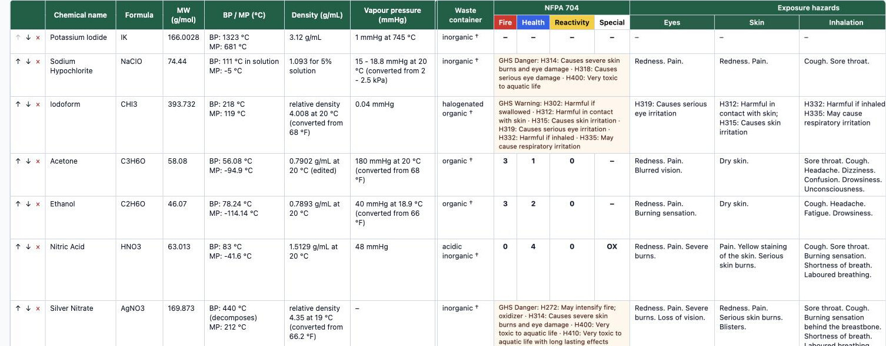
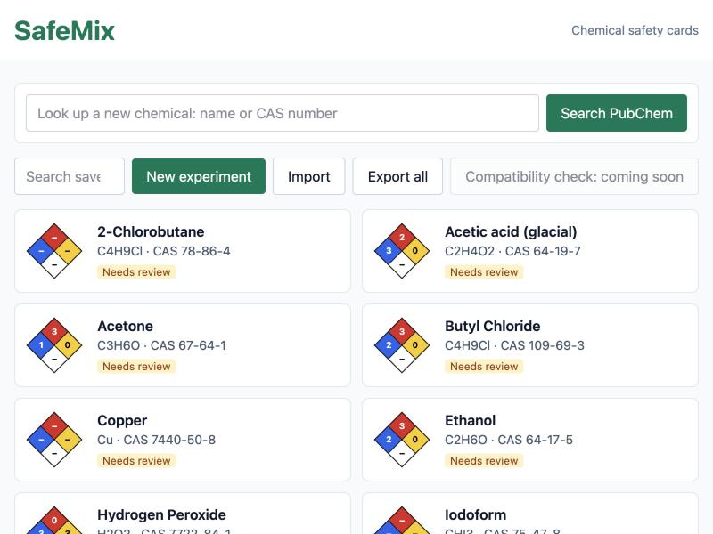
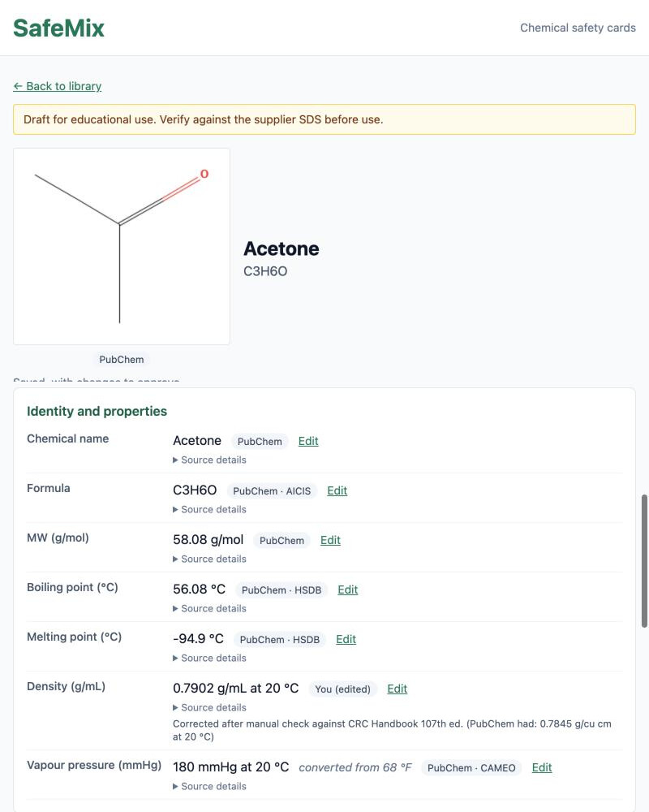
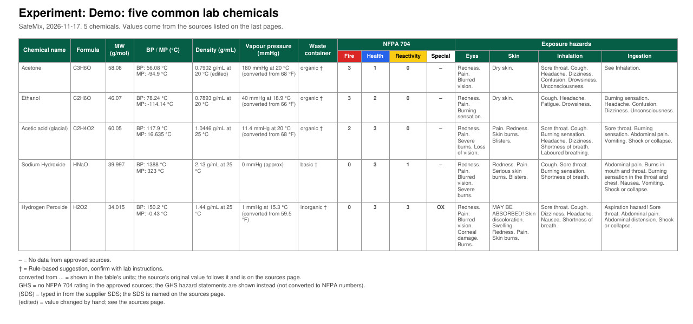

# SafeMix

**Type a chemical's name and get the row for your lab's chemical table, where every value shows its source or is marked "Not verified".**

SafeMix is a browser app that helps you prepare for a chemistry lab. You search a chemical by name or CAS number and get one compact card with the columns of a teaching lab's chemical table: formula, MW, boiling and melting point, density, vapour pressure, waste container, NFPA 704 rating and exposure hazards by route. Each value from PubChem links to the record it came from, and a value you type in without a named SDS is marked "Not verified". If no approved source has a value, SafeMix leaves it empty and says so. It never guesses a value.

**Live demo:** https://shmuelinitzan-cmd.github.io/safemix/ (no sign-up; 5 demo chemicals included)



## Why

Preparing for a lab means filling the same table for every chemical: properties, NFPA rating, exposure hazards and the right waste container. Students usually copy these from different websites, so the values come with no source and some of them are wrong.

SafeMix fills the table from approved sources and shows where each number came from. I built it as a second-year chemical engineering student. Before that, I mixed agricultural spray chemicals in Australia, working from their safety data sheets (SDS).

## What it does

- **Search a chemical.** Look it up by name or CAS number. The data comes live from PubChem (NIH).
- **Cited values.** On a card, every value has a source badge and a date, and values from PubChem link to the record. You can open the source details to see the original text.
- **"Not verified" values.** A value typed in by hand without a named SDS is marked "Not verified" on the card, in experiment tables and in exports.
- **Missing means missing.** A value that no approved source has shows as "No data from approved sources".
- **Experiment tables.** Pick chemicals into a table that follows the lab form's column order, then reorder rows and save.
- **Export.** Get a print-ready PDF (landscape, in the lab form's column order, with every source listed on the last pages), a CSV for Excel, or a JSON backup of the whole library that you can import on another computer.
- **Solution cards.** You can make "Nitric acid, 5%" from the pure compound. Only the formula and MW carry over, because the pure compound's properties don't apply to a dilute solution.
- **Supplier SDS entries (optional).** You can type a value from a supplier's SDS. The SDS has to be named (supplier, product number, revision date), and the value is marked "(SDS)" everywhere it appears.

| Library | Chemical card |
|---|---|
|  |  |



## How the data stays honest

These rules are written in the code and covered by tests:

1. **Approved sources only.** PubChem, which brings together HSDB, ICSC, CAMEO and ECHA records, plus values the user types from a named supplier SDS.
2. **The source text is stored as given.** Unit conversions are for display only and are labelled, for example "180 mmHg at 20 °C (converted from 68 °F)".
3. **Fixed rules for choosing a value:**
   - Vapour pressure: the value measured closest to 20 °C.
   - Boiling point, melting point and density: the first value already in the card's unit.
4. **GHS as a fallback, never as a conversion.** Some chemicals have no NFPA rating in any approved source. For those, SafeMix shows GHS hazard statements instead: from the ECHA summary, those that at least half of the notifiers reported or that have no percentage. If there is no ECHA entry, it uses another GHS entry and the card names that source. It does not translate GHS into NFPA numbers, because the two systems rate hazards differently.
5. **Waste container by a documented rule.** The suggestion is based on the formula (halogen in an organic compound → halogenated organic, and so on). It stays marked as a suggestion until a person confirms it.
6. **A person approves every card** before it counts as reviewed.

## Tested on a real experiment

I used SafeMix to rebuild the chemical table for a real organic chemistry lab: iodoform preparation and identification tests for alkyl halides, 12 chemicals. Then I compared it with the same table filled in by hand.

- **Formula, MW, BP/MP and density:** filled for all 12 and close to the hand-filled values. SafeMix also filled melting and boiling points that were missing from the hand-filled table.
- **Safety columns:** NFPA or GHS hazard data for 10 of 12 chemicals, with no manual entry.
- **Inconsistencies found in the hand-filled table:**
  - **Not verified:** a vapour pressure too low for the compound's boiling point.
  - **Not verified:** a fire rating of 3 for a non-flammable salt.
  - **Not verified:** a row that mixed values for the pure acid and for its dilute solution.

## Data sources

| Source | Used for |
|---|---|
| [PubChem](https://pubchem.ncbi.nlm.nih.gov/) (NIH), PUG REST / PUG View | All card fields, live |
| ICSC (ILO-WHO), via PubChem | Exposure symptoms by route |
| ECHA C&L notifications, via PubChem | GHS hazard statements, used only where ICSC or NFPA data is missing |
| HSDB, CAMEO Chemicals (NOAA), via PubChem | Physical properties, NFPA 704 |
| Supplier SDS, typed in by the user | Optional, for gaps and for solutions |
| CRC Handbook | Manual reference, not included in the app. The only documented correction is the acetone density in the demo cards |

## Tech

- **App:** Vite, React, TypeScript and Tailwind CSS. It runs entirely in the browser, with no server and no login.
- **Storage:** IndexedDB (Dexie). Your library stays on your own computer.
- **PDF export:** jsPDF and jspdf-autotable.
- **Tests:** 160 Vitest tests covering data parsing, unit handling, the GHS rule, waste rules, import validation and exports.
- **Hosting:** GitHub Pages, deployed by GitHub Actions.
- **Built with:** AI-assisted development (Claude Code), following the written specification in [SPEC.md](SPEC.md).

### Run it locally

```bash
git clone https://github.com/shmuelinitzan-cmd/safemix.git
cd safemix
npm install
npm run dev     # open the address it prints, usually http://localhost:5173
npm test        # run the tests
```

## Roadmap

- **Compatibility matrix:** cross-check the chemicals of an experiment for dangerous combinations (Compatible, Caution or Incompatible, each with its source).
- **Shared lab library:** one approved library that every student in a lab uses.
- **Optional AI reading of supplier SDS PDFs:** the AI could only quote text from the uploaded file, and the code would check every value against that file.

## Disclaimer

SafeMix produces draft safety cards for education and lab organisation. It is not a legally valid SDS and does not replace the supplier's sheet or the lab safety officer.

---

Built by **Nitzan Shmueli**, chemical engineering student at Shenkar College.
